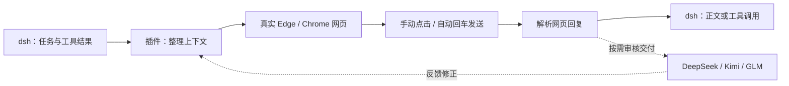

<div align="center">


# DeepSeek 网页通道

**用你已登录的 DeepSeek 网页，接入 dsh 的任务与工具工作流。**

真实 Edge / Chrome · 半自动与全自动 · 默认只展示结果 · 可选 Kimi / GLM 审核

[](https://www.npmjs.com/package/dsh-deepseek-web-xxxxxgold) [](https://github.com/xxxxxgold/dsh-deepseek-web/releases/latest) [](LICENSE) [](https://github.com/deepseek-ai/deepseek-harness)

[快速安装](#quick-start) · [功能一览](#features) · [工作原理](#how-it-works) · [常见问题](#faq) · [更新记录](CHANGELOG.md) · [赞助支持](#sponsor)

</div>

<a id="quick-start"></a>
## 从安装到第一条消息

准备好 **dsh 桌面版 0.2+、Edge 或 Chrome，以及 DeepSeek 网页账号**。
普通桌面版用户无需安装 Node.js、下载源码或手改配置文件。

1. 打开 dsh 左侧栏 **插件 → 添加插件**。
2. 粘贴下面的发行包链接，点击 **安装**。
3. 安装后点击 **立即启用**，然后重启 dsh。
4. 选择 `deepseek-web`，在自动打开的浏览器窗口登录 DeepSeek；网页填入消息后，点击发送。

```text
https://github.com/xxxxxgold/dsh-deepseek-web/releases/download/v0.7.0/dsh-deepseek-web-xxxxxgold-0.7.0.tgz
```

当前正式版为 **0.7.0**。
希望消息填入后自动发送，可改选 `deepseek-web-auto`。

> [!IMPORTANT]
> 本项目的包名是 **`dsh-deepseek-web-xxxxxgold`**。
> npm 的 `dsh-deepseek-web` 属于另一位作者，不是本仓库的发行包。
> 从本项目旧版升级时，先记下自定义设置、卸载旧包，再安装新版并重启。
> 不要同时启用新旧包；正常卸载保留浏览器登录态和运行数据。

<details>
<summary><b>其他安装方式：npm 包名 / 本地安装包</b></summary>

**npm 包名**（`0.7.0` 已推送到 npm 后可用）：

```text
dsh-deepseek-web-xxxxxgold@0.7.0
```

填包名时安装源选 **npm 官方源**；中国大陆镜像源可能尚未同步。
若提示找不到该包，说明 npm 版还没发布，请改用上面的 GitHub 发行包链接。

或从 [Release](https://github.com/xxxxxgold/dsh-deepseek-web/releases/latest) 下载 `.tgz`，粘贴文件的完整绝对路径，例如：

```text
C:\Users\你的用户名\Downloads\dsh-deepseek-web-xxxxxgold-0.7.0.tgz
```

发行包已包含 host/client 编译产物。安装依赖仍需要网络；镜像尚未同步时选择 npm 官方源。
切换 npm 镜像不能代替 GitHub 下载。

</details>

完整中文步骤、升级和卸载见 **[安装速查](INSTALL.md)**。

<a id="features"></a>
## 按你的工作方式使用

| 能力 | 你可以怎么用 |
| --- | --- |
| 🌐 **真实网页通道** | 插件启动独立 Edge / Chrome 窗口，复用其中的网页登录态；无需 API Key。 |
| 🎛 **两种发送方式** | 半自动模式先查看填入的内容再点击发送；全自动模式填入后自动回车。 |
| 📝 **结果直接呈现** | 默认展示最终正文或工具调用；网页委托正文完整返回，不再受旧版 6000 字符裁剪影响。 |
| 🧵 **长任务接续** | 同步任务上下文；宿主压缩后，利用检查点与近期消息建立接续对话。 |
| 🔎 **可选交付审核** | 使用 DeepSeek 同对话自审，或独立 Kimi / GLM 网页通道复核交付。 |
| ⚙️ **设置里的配置菜单** | 侧栏「设置 → DeepSeek 网页」一页改完常用参数，点保存即写回 profile。 |

### 选哪种模式？

| 模型入口 | 发送方式 | 适合的使用习惯 |
| --- | --- | --- |
| `deepseek-web` | 填入后由你点击网页发送 | 希望逐轮检查输入，再继续执行。 |
| `deepseek-web-auto` | 填入后自动回车发送 | 已确认任务和配置，希望连续运行。 |

这是**发送方式的区别**，不是两个不同的大模型。思考与联网开关由网页自身管理。
模式不会改变 dsh 对本地工具的权限与审批设置。

### 在哪里调整设置？

两个入口读写同一份配置：

- **设置 → DeepSeek 网页**（推荐）：按「网页连接 / 网页模型与发送 / 风控模式 / 图片直传 / 审核通道 / 频控自动重发 / 过程提示 / 浏览器自愈 / 登录探活 / 工具与委托 / 窗口聚焦 / 压缩摘要」十二组排布，常用参数一页改完（回合超时、锁租约等进阶字段仍走 profile patch，见[进阶文档](docs/ADVANCED.md#配置)）。
- **插件 → `dsh-deepseek-web-xxxxxgold` → `llm-deepseek-web` → 配置**：插件管理器里的同一份表单。

页面上的行为：

- **保存一次到位**：改完点「保存」或按 `Ctrl+S`／`⌘+S`，同屏改的多个字段作为一次原子提交写入 profile 的 `cordis.patch.yml`；写失败保留草稿并提示，不会出现「一半生效一半没生效」。
- **草稿态**：改动先留在当前页面，徽章显示「有未保存的改动」；「放弃修改」丢弃草稿，「重新读取」拉回宿主当前值。
- **逐字段校验**：端口超出 1024–65535、重试次数越界等当场标红并禁用保存。
- **恢复默认**：被改过的字段右侧有「恢复默认」，把该项从 patch 里删掉、回到插件默认值。
- **重启生效标识**：浏览器连接模式、独立浏览器类型、独立浏览器 profile 目录三项标「重启生效」——重启 DSH 后生效，其余字段保存即生效。
- **只看结果**：关闭「显示网页思考过程」，即 `liveThinking: false`，这也是默认值。
- **选择浏览器**：`browser` 选 `managed` 由插件托管独立窗口（`channel` 选 `msedge` 或 `chrome`），选 `attach` 则连接已开启 CDP 的浏览器。
- **开启审核**：打开 `review.enabled`，选择 `deepseek-web`、`kimi` 或 `glm`。

审核默认关闭。DeepSeek 自审不需要额外浏览器；Kimi / GLM 需要先在对应独立窗口登录。
[查看完整配置与审核准备](docs/ADVANCED.md#审核通道)。

<a id="how-it-works"></a>
## 一条消息如何完成



消息由 **DeepSeek 网页本身**发出；插件操作输入框与发送入口，并读取网页请求的响应。
登录态保存在插件专用浏览器 profile 中。网页布局、接口或账号状态变化都可能影响使用。

正常任务使用工作标签；dsh 的内部摘要与标题请求使用独立临时标签，完成、失败或取消后关闭。
半自动模式下，内部请求也需要点击发送；全自动模式会自动发送。

<a id="self-check"></a>
## 自检与调用台账

设置页底部是一张只读卡片，数据全部来自本机，不出网：

- **调用台账**：按天记录每次网页调用的时间、用途（对话 / 辅助 / 审核）、结果与失败分类，只保留最近 7 天，**不记录对话内容与任何凭证**。卡片直接给出相邻对话间隔的最短 / 中位 / p90——最短间隔最能说明有没有连环请求。
- **本机自检**：点一下按钮就跑一遍浏览器可执行文件、profile 可写性、登录态、输入框与发送按钮选择器、当前节流参数。检查项只报事实，不做修复，末尾给出 `ready` / `not ready`。

命令行等价物：

```bash
npm run doctor             # 全量（会连接或拉起浏览器）
npm run doctor -- --offline  # 只看静态项，不碰浏览器
```

「账号是否被限流」这类本地无法证明的事，自检会明确报 warning 而不是装作全部正常。

<a id="faq"></a>
## 常见问题

<details>
<summary><b>升级了，为什么还显示很多思考？</b></summary>

旧配置显式保存了 `liveThinking: true` 时，升级会保留它。进入配置页关闭「显示网页思考过程」即可。
这只影响 dsh 展示，不关闭 DeepSeek 网页思考模式，也不删除已有对话记录。

</details>

<details>
<summary><b>长正文还会被截断吗？</b></summary>

旧版对网页委托正文的 6000 字符裁剪已移除，最终正文和网页委托结果完整返回。
`maxToolResultChars` 仍限制本地工具结果送入网页模型的长度；这是工具输入的限制。

网页自身仍有生成和上下文上限。网页明确报告截断或中断时，插件会报错；站点没有报告原因时，
无法保证识别所有截断，也不能保证网页执行宿主的 `maxTokens`。

</details>

<details>
<summary><b>为什么出现英文交接摘要，或者任务突然变了？</b></summary>

dsh 的内部压缩请求可能要求生成英文交接摘要，它应作为后续任务上下文。
0.2.12 起，插件隔离这类辅助请求，并在压缩后恢复任务检查点；它不会把所有英文回复一律过滤。

升级并重启后继续原任务即可，无需删除状态文件。宿主历史已经缺少任务信息时，需重新说明任务。
[查看压缩接续的恢复条件与限制](docs/ADVANCED.md#context-recovery)。

</details>

<details>
<summary><b>同时开几个会话，会抢同一个网页标签吗？</b></summary>

不会。**每个 dsh 会话独占一个网页标签页**，主会话和它派生的子代理也各拿一个
（两个不同的 sessionId），各自带一把会话锁，所以不同会话可以同时跑，同一会话的
多个请求仍然串行（它们共用同一个网页对话）。

三个边界：

- 标签页上限是 `maxSessionPages`（默认 3）。超了会回收「最久未用且当前没在跑」的那一页；
  被回收的会话下次请求会重新回放一遍宿主上下文，**任务不会丢，只是那条会慢一点**。
- dsh 内部的压缩摘要、会话标题这类辅助请求走**一次性临时标签页**，用完就关，
  不占上面这个上限，也不占会话锁。
- 但全局还有 `maxConcurrentTurns`（默认 1）：多会话各占自己的标签页，同一时刻只有
  一条请求真正打网页，其余按先进先出排队。原因是网页端的频控和临时封禁按**账号**结算，
  不是按标签页——同时开两条生成最容易触发。

</details>

<details>
<summary><b>可以直接把图片交给模型看吗？</b></summary>

可以，默认开启（配置页的「图片直传」开关）。

开启后，消息里的图片会真的被放进网页输入框，由网页端自己上传并把
`ref_file_ids` 随消息发出，模型直接看到原图——效果与你手动把图片拖进
chat.deepseek.com 一致。插件不自己拼上传接口，只触发网页端自己的上传流程，
因此解析状态（PENDING → PARSING → SUCCESS）也是网页端在管。

几个边界：

- 单张 100MB、单轮默认 4 张（配置页可调）；超过 45MB 的图走 CDP 读本地文件，
  不走 Playwright 的内联传输。
- 关掉开关，或宿主没有提供附件服务时，退回 `[附图: 文件名]` 文本标记，
  并在系统协议里明确告诉模型"看不到图片内容，不要猜"。
- 文件附件（PDF、代码等）仍只转成文字标记，暂未上传；超长正文是例外，见下面
  「一轮几十万字」那条。
- 图片仍无法上传时（网页结构变更、账号限制），`uploadOnError` 决定本轮是
  报错停下（`abort`）还是降级继续（`fallback-text`，默认）。

</details>

<details>
<summary><b>一轮几十万字，输入框卡很久怎么办？</b></summary>

不用手动拆。正文达到 `longTextFileThreshold`（默认 120 000 字，配置页可调）时，
插件不再把全文塞进输入框，而是写成 `dsh-turn-<时间戳>.md` 作为附件上传，
输入框只放一段摘要：本轮共多少字、附件名、开头 3000 字，并要求模型先读附件再执行。

原因是网页输入框填字代价随文本长度接近二次方增长：实测 30 万字符约 13 秒、
60 万约 77 秒、110 万字符能把页面主线程拖死数分钟。

两个兜底：文件上传失败（网页结构变更、解析超时）时自动改填完整正文，本轮照常发出；
把「长正文转文件」关掉（`longTextAsFile: false`）就恢复旧行为。

</details>

<details>
<summary><b>安装失败，或者安装后没有模型？</b></summary>

先确认装的是本项目：包名是 `dsh-deepseek-web-xxxxxgold`，或粘贴上面那条 GitHub 发行包链接。
安装后点击「立即启用」并重启；在插件页检查 `llm-deepseek-web` 是否启用、有没有错误。

如果 GitHub 链接下载失败，可以等 `0.7.0` 发布到 npm 后改用包名安装（安装源选 npm 官方源）。
[更多安装排查](INSTALL.md#其他安装入口与常见问题)。

</details>

<details>
<summary><b>登录态在哪里？卸载会清掉吗？</b></summary>

Windows 默认数据目录是 `%LOCALAPPDATA%\DshDeepSeekWeb\`，可在配置中指定浏览器 profile。
正常卸载保留这些数据。需要彻底清除时，在停用插件并关闭对应浏览器后，手动删除不再需要的数据。

</details>

本项目是社区插件，与 DeepSeek 官方无隶属关系。通过真实浏览器操作不代表无法被检测；
网页可用性、账号状态和网络环境均由对应服务决定。

<a id="命令行--手动-profile进阶"></a>
## 配置与进阶使用

| 文档 | 内容 |
| --- | --- |
| [INSTALL.md](INSTALL.md) | 中文安装、升级、首次登录与卸载。 |
| [配置与进阶使用](docs/ADVANCED.md) | CLI / profile、CDP attach、完整配置表、审核与压缩接续。 |
| [CHANGELOG.md](CHANGELOG.md) | 版本修复与包名迁移记录。 |
| [RELEASING.md](RELEASING.md) | 维护者的打包、认证、发布与验证流程。 |

## 开发与验证

源码开发需要 **Node.js 22+**，并满足宿主提供的 `@deepseek-ai/*` 与 React peer 依赖。

```bash
npm install
npm run build
npm run test:parsers
npm run doctor     # 可选：本机体检（浏览器 / profile / 登录态 / 输入框 / 调用节奏）
npm pack
```

构建生成 `lib/index.js` 与 `lib/client.js`，发行包无需用户编译。
35 项离线检查覆盖 SSE 解析、工具动作、频控、冷却与重试预算、调用台账、工具目录预算、用量、长委托回复、辅助调用隔离与压缩接续。
`npm run doctor` 只报事实不做修复，`--offline` 跳过需要拉起浏览器的检查。
浏览器隔离使用模拟页面验证；网页登录、站点结构及发送行为需要真实网页另行验证。

<details>
<summary><b>项目结构</b></summary>

```text
src/                 host/client TypeScript 源码
lib/                 发行包构建产物
tools/               登录、诊断与离线检查
docs/                进阶文档与首页插图
dsh.patch.yml        桌面版 bundle patch
INSTALL.md           中文安装速查
CHANGELOG.md         版本更新记录
RELEASING.md         维护者发布流程
```

</details>

## 反馈问题

通过 [GitHub Issues](https://github.com/xxxxxgold/dsh-deepseek-web/issues) 提供插件与 dsh 版本、
使用的发送模式、复现步骤，以及相关错误或最后一段回复。日志中的登录凭证请先隐藏。

<a id="sponsor"></a>
## 赞助支持

**项目免费开源，赞助完全自愿，不影响任何功能的使用。**

如果这个插件帮你省下了时间，欢迎通过微信扫码支持作者，鼓励后续维护与功能改进。
金额随心，感谢每一份支持！点亮 Star、分享项目和反馈问题，同样是很好的支持方式。

<p align="center">
  <a href="docs/assets/wechat-sponsor.jpg">
    
  </a>
</p>
<p align="center">使用微信扫一扫；手机访问时可点击图片查看原图，保存后在微信中识别二维码。</p>

项目按 [MIT License](LICENSE) 开源。
